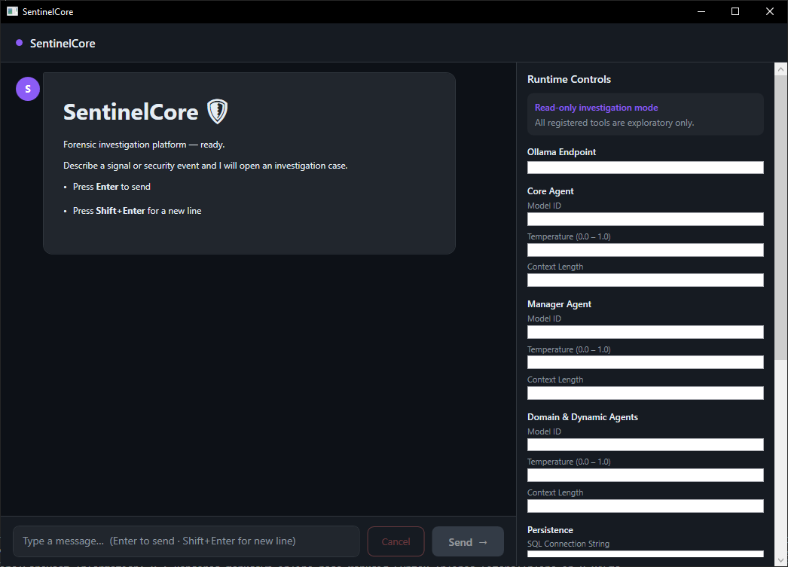
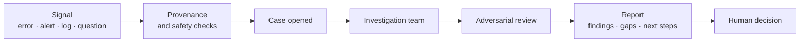

<div align="center">

# Sentinel Core

### 2:14 a.m. Something breaks. By 2:20 a.m., someone already knows why.

**An AI investigation team for the systems you cannot afford to guess about.**

[The problem](#the-problem) · [How it works](#how-it-works) · [Why it is different](#what-makes-sentinel-core-different) · [Where we are](#where-we-are-today) · [For engineers](#for-engineers)



</div>

---

## The problem

Every organisation runs on systems that never stop talking. Event logs, alerts, service failures, security findings, configuration drift, help-desk tickets — a constant stream of signals that something is wrong, or about to go wrong.

The expensive part is rarely the fix. It is the *knowing*.

Working out what actually happened means a skilled person sitting down with scattered evidence and doing the slow, careful work of an investigator: gathering logs, reading vendor documentation, forming a theory, testing it, discovering it was wrong, forming another one. That work is measured in hours and days, not seconds — and it is done by exactly the people an organisation can least afford to tie up.

The consequences compound:

- **Expertise does not scale.** The best investigator in the building is one person, and they are always busy.
- **Conclusions depend on who is on shift.** Two analysts, two different answers, two different levels of confidence.
- **The evidence was there all along.** Most root causes are discoverable. They are simply buried under volume, noise, and documentation nobody has time to read.
- **Regulated industries are stuck.** The organisations with the most to gain from AI — healthcare, finance, defence, manufacturing — are the ones who cannot send their data to a cloud service.

Sentinel Core was built to change that.

---

## What Sentinel Core is

Sentinel Core is an **AI-assisted forensic investigation platform** for Windows.

You give it a signal — an error code, an alert, a suspicious log entry, a failing service, or simply a question in plain English. It does not guess an answer. It runs an **investigation**: collecting evidence, researching the documentation, building a case, attacking its own conclusions, and producing a report you can defend.

Think of it as a tireless senior investigator who never gets bored, never skips the documentation, and never pretends to be certain when the evidence is not there.

It is not a chatbot that sounds confident. It is a structured process — evidence first, conclusions last.

---

## How it works



**1. A signal comes in.**
Anything the system can observe, or anything a person can describe. A log line, a failed backup, an unexpected registry change, a security alert, or a question typed into the console.

**2. It is checked before anyone acts on it.**
Every incoming message is first verified for provenance — is it genuinely from a known source, and has it been altered or replayed? — then screened by a safety layer, then routed. Simple questions get a direct answer. Anything substantive becomes a **case**, with an identity, a state, and a record.

**3. An investigation team goes to work.**
The heart of Sentinel Core is a coordinated team of AI specialists, built on Microsoft's Agent Framework:

| Role | What they do |
| --- | --- |
| **Manager** | Plans the investigation and keeps the team on task |
| **Evidence collector** | Gathers the facts — logs, configuration, system state, tool output |
| **Researcher** | Reads the documentation so nobody has to guess |
| **Adversarial analyst** | Tries to break the leading theory before you rely on it |
| **Report writer** | Turns the whole investigation into a clear, structured account |

The team works in **bounded rounds**, so an investigation converges instead of wandering. It adapts its approach to the evidence it finds rather than following a fixed script.

**4. Every conclusion is challenged.**
This is the part that matters most. A leading explanation is not accepted because it sounds right — it is tested against competing theories. Supporting evidence, contradicting evidence, and *missing* evidence are all reported.

**5. You get a report, not a verdict.**
What happened. What supports that conclusion. What argues against it. What is still unknown. And, where possible, what to do next.

Then a human decides. Always. Sentinel Core will never make a change to your systems on its own. It investigates, it recommends, it never acts. 

> **A successful investigation is not one that always finds a root cause.** It is one that accurately characterises the evidence, states its uncertainty honestly, and gives you a defensible basis for action. "Inconclusive" is a valid — and respected — outcome.

---

## A night in the life

A server starts throwing intermittent errors at 2 a.m. Nobody is awake. The alerts stack up in a queue.

By morning, instead of a tired engineer starting from zero, there is a completed investigation waiting:

- The failing component and the exact error signature.
- The three most likely causes, ranked, each with the evidence behind it.
- The change made eleven days earlier that correlates with the first occurrence — and the one that turned out to be a red herring.
- The two vendor knowledge-base articles that describe the behaviour and the documented workaround.
- The gap in the evidence, stated plainly: two log sources had rotated, so the earliest occurrences cannot be reconstructed.
- A recommended remediation path, with the risk of each step noted.

The engineer spends twenty minutes validating a conclusion instead of a day building one. And the whole investigation is on record — every step, every source, every judgement — if anyone ever needs to ask *how* that conclusion was reached.

That is the difference between automating an answer and automating an *investigation*.

---

## What makes Sentinel Core different

**Evidence before conclusion.**
The system is designed to refuse to manufacture certainty. When evidence is incomplete or contradictory, it says so. That single design choice is what makes the output usable in an audit, a post-incident review, or a courtroom.

**It argues with itself.**
Most AI systems optimise for sounding helpful. Sentinel Core includes a dedicated adversarial role whose job is to attack the leading theory. Disagreement is a feature, not a failure.

**It is not tied to one industry.**
Sentinel Core is domain-agnostic by design. A pluggable knowledge layer lets the same engine investigate Windows failures, security incidents, manufacturing anomalies, or clinical systems — you bring the domain knowledge, the platform brings the investigative discipline.

**It runs where your data lives.**
With a local model, Sentinel Core operates **fully air-gapped**. No internet connection, no data leaving the building. For organisations that cannot put their evidence in someone else's cloud, this is the difference between adopting AI and being unable to.

**It uses the model you already trust.**
Local models through Ollama or ONNX Runtime, or a cloud provider you already have a relationship with — OpenAI, Azure OpenAI, GitHub Models, Anthropic, Azure AI Foundry. The investigation discipline is the product; the model is a component you choose. Each role may have a different model, and the system can be configured to use multiple models in parallel for comparison. Each model can also be tuned using a variety of performance and safety parameters, such as temperature, top-p, top-k, and others. The platform is model-agnostic, so you can swap in a new model, and the investigation discipline remains the same.

**It touches nothing.**
Sentinel Core performs **zero destructive operations**. It investigates, it recommends, it never changes your environment on its own.

**It plugs into your environment.**
Capabilities arrive through the **Model Context Protocol (MCP)** — an open standard for connecting AI to real tools and data. Windows diagnostic tooling, Microsoft Learn research, internal systems, are standard. Have a special server with your own brand of software, no problem attach a different Sentinel Core MCP server package with tools and knowledge for that environment. The platform is extensible, so you can add your own tools and knowledge sources.

**Every message is stamped, every case leaves a record.**
Messages carry cryptographic provenance stamps that detect tampering and replay. Anything that fails verification is quarantined, unchanged, and never reaches a model — the platform fails closed rather than guessing. Beyond that, a detailed transactional history can be written to disk for accountability and audit, and team reasoning and debate can be surfaced so the pipeline is inspectable end to end rather than a black box.

---

## Where it fits

| Who | What it gives them |
| --- | --- |
| **IT operations teams** | Faster root-cause analysis on failures, without pulling senior engineers off other work |
| **Security operations** | Structured triage of alerts with an adversarial check on every conclusion |
| **Managed service providers** | Consistent investigative quality across every customer and every technician |
| **Regulated industries** | AI-assisted analysis that can run entirely on-premises, with a full audit trail |
| **Compliance and audit** | Findings that distinguish observed fact from inference from assumption |
| **Engineering and manufacturing** | A general investigative engine that can be pointed at any domain with evidence |

---

## Where we are today

Sentinel Core is a **working early-stage platform**, not a finished commercial product. We would rather tell you exactly what is real than oversell what is not.

**Working today**

- Signal-driven investigations, end to end, from a Windows desktop console
- A multi-agent investigation team — one manager and four specialists — running in bounded rounds
- Cryptographic message provenance, replay detection, and fail-closed quarantine
- Breadth across local and cloud model providers
- A tool ecosystem built on MCP, with runtime registration and management
- A deterministic case lifecycle, where every state change is validated
- A safety layer with 13 built-in rules covering prompt injection, code injection, data exfiltration, PII, role escalation, system-prompt extraction, and more — extensible with your own
- A full event and audit stream for UI integration and record-keeping
- 33 distinct expert perspectives that produce genuine disagreement and better reasoning

**In active development**

- **Knowledge retrieval** — keyword and fuzzy search are live; vector search is designed and waiting on an embedding provider
- **Pattern memory** — Sentinel Core learns from every case, by saving every case report with details and creates searchable index vectors that allows the system to bypass investigations when the parameters match, this saves your token costs and storage overhead. The case details are passed on and verified by the adversarial analyst before giving the report to operator. No guess work is acceptable. If a parameter is slightly off from a past case it is run through the team again. So the system does not learn from incorrect conclusions. 
- **Safety hardening** — rules evaluate correctly, but the block-routing path is not yet fully wired. This is a known gap and is prioritised, not hidden
- **Persistence and packaging** — database-backed case storage is in place; installer and deployment experience are not, schema is still evolving
- **Operator defined signal whitelisting** - Does your environment produce signals that are benign or expected? You can define a list of those signals so that they are logged but no case opens.
- **Alternate Orchestration Strategies** - The current orchestration strategy is a single team of agents. Framework is in place for multiple ochestration patterns, patterns themselves are not. We may include one or two others if time permits. To keep local model requirements low, agent operations are serialized and not parallelized. 

---

## Why now

Three things changed at once, and they point in the same direction.

**AI agents became useful.** Not as chatbots, but as bounded, supervised, tool-using workers that can be held to a process. Microsoft's Agent Framework makes that discipline buildable. Sentinel Core exists because that window just opened.

**The pressure went up, not down.** Alert volume keeps rising while the pool of experienced investigators stays flat. Every organisation feels the same squeeze: more signals, fewer people who can interpret them.

**Software is more complex than ever.** The systems that run the world are no longer simple, single-vendor stacks. They are multi-vendor, multi-cloud, multi-platform, and multi-generational. The evidence is there, but it is scattered across logs, documentation, and configuration that nobody has time to read. Windows is a spiderweb and can have fifty connections across the whole ecosystem and just one out of place can cause cascading failures. The only way to keep up is to automate the investigation, not the answer.

**Trust became the constraint.** The organisations with the biggest problems to solve are the ones with the strictest rules about where data can go and how decisions must be justified. A system that runs locally, touches nothing, and documents every step is not a nice-to-have for them — it is the entry requirement.

And the defensibility is not in the model. Models are a commodity and they improve every quarter — which works in our favour, because Sentinel Core is model-agnostic and inherits every improvement for free. The defensibility is in the **investigative discipline**: evidence-first reasoning, adversarial review, tamper-evident provenance, a domain-agnostic knowledge layer, and a tool ecosystem built on an open standard.


Authors Note: I have spent nearly 40 years in the IT industry, and I have seen these scenarios play out and spent days chasing one ghost after another, spent more time on Google than the developers, searching for the evidence that ties it all together. Every signal a learning experience and new questions to answer. Sentinel Core is the culmination of that experience, and my goal to bridge the gap and free up IT professionals and allow them to be proactive instead of reactive. It should also allow them to focus on more infrastructure and less troubleshooting.

---

## For engineers

Sentinel Core is a .NET 10 solution with a WPF host, built on the Microsoft Agent Framework. The architecture is deliberately layered: a zero-dependency contracts layer, a case-flow engine that owns state, an orchestration layer that assembles agents and workflows, an independent security module, and a UI that acts purely as composition root.

```
projects/
├── SentinelCore.Contracts/        # Zero-dependency shared abstractions
├── SentinelCore.CaseFlowEngine/   # Case lifecycle, persistence, pattern memory
├── SentinelCore.Orchestrations/   # Agents, workflows, safety, RAG, MCP, DI
├── SentinelCore.Security/         # Provenance stamps, signatures, quarantine store
└── SentinelCore.UI/               # WPF host application (composition root)
```

**Prerequisites:** .NET 10 SDK, SQL Server for persistence, and Ollama for local models or any one of the popular model providers for inference.

Full setup, dependency-injection wiring, model tier configuration, MCP server registration, and the case lifecycle are documented in the component guides:

| Document | Contents |
| --- | --- |
| [docs/GettingStarted.md](docs/GettingStarted.md) | Setup, DI registration, events, and first investigation |
| [docs/SolutionArchitecture.md](docs/SolutionArchitecture.md) | Full architecture overview |
| [docs/OrchestrationComponent.md](docs/OrchestrationComponent.md) | Orchestration layer details |
| [docs/CaseFlowEngineComponent.md](docs/CaseFlowEngineComponent.md) | Case lifecycle and state machine |
| [docs/SafetyEngineComponent.md](docs/SafetyEngineComponent.md) | Safety engine details |
| [docs/SecurityComponent.md](docs/SecurityComponent.md) | Provenance and quarantine |
| [docs/McpServerRegistryComponent.md](docs/McpServerRegistryComponent.md) | MCP server registry |
| [docs/MemoryLayerComponent.md](docs/MemoryLayerComponent.md) | Pattern memory |
| [docs/ToolingComponent.md](docs/ToolingComponent.md) | Tool groups, selection, and assignments |
| [docs/ProjectTerminology.md](docs/ProjectTerminology.md) | Canonical terminology |
| [architecture/pattern-lock.md](architecture/pattern-lock.md) | Authoritative architectural rules |

See also the [Mission Statement](MissionStatement.md) for the principles the platform is built on.

---

## Interested?

Sentinel Core is at an early, pre-commercial stage. If you run systems that keep you awake at night, if you are evaluating AI for an environment that cannot send data to the cloud, or if you are looking at this space as an investor or partner — we would like to hear from you.

Open an issue, or reach the maintainer through [@KyleC69](https://github.com/KyleC69).

---

## License

The code in this repository is released under the [MIT License](LICENSE).

The AI agent patterns and orchestration designs are proprietary and require special permission to use in whole or in part. The Microsoft Agent Framework (MAF) is owned by Microsoft, and no rights to it are claimed here beyond normal end-user licensing.

---

<div align="center">

*A very special thank you to the Microsoft Agent Framework team. This framework moves fast — new types, new capabilities, every commit — so we built a dedicated retrieval system just to keep our agents current with it. When you peel back the layers, it is remarkably powerful and remarkably flexible. If you ever want to build something serious with AI, start here.*

</div>
