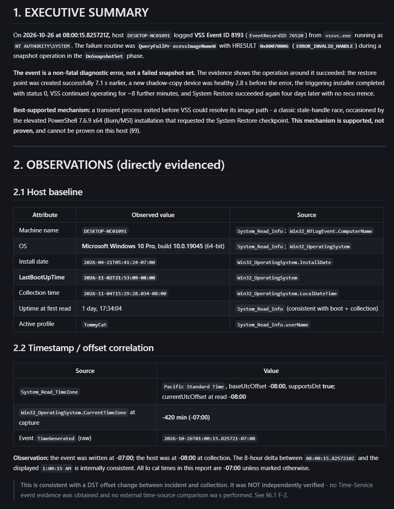
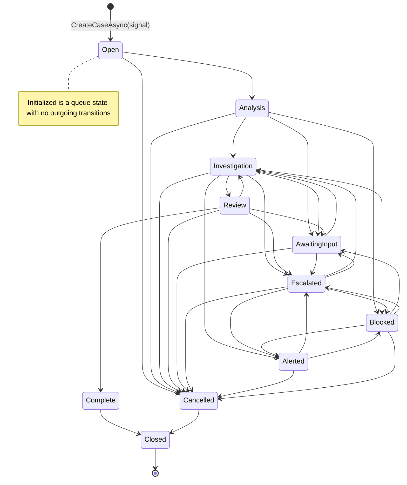

# Sentinel Core

**Advanced AI Assisted Forensic Investigation Platform for Windows**

### **STATUS UPDATE 11/14** I have solved the workflow instability with the investigation team and can move forward. The solution can be seen in the CustomGroupWorkflow.cs file. The agents are displaying emergent behavior and are flowing naturally adapting to each case

The group orchestration this application uses is very complex and the nature of forensics demands a very high level of accuracy and precision. There is a delecate balance between the layered instruction sets, the built-in templates used in the orchestrations and the models interpretations of it all.

---


Sentinel Core utilizes the power of AI as a forensic level investigation platform. It takes input(signal) from almost any telemetry source or human operator and starts an investigation into the factors that produced the signal. This system is not locked to any one domain or implementation, the agents have a layered instruction set that starts broad and becomes targeted depending on the agents role and current task. It is these instruction sets that determine the domain it currently operates in or targets in the investigation, making it an extremely versatile application.

The tools available to the agents are packaged as an MCP server and can be changed to coincide with the current implementation(domain). The system also allows addition of 3rd party MCP servers which are valuable for adding specific domain knowledge to the research agents. This system is highly adaptive to it's host environment and makes no assumptions to it's operating environment, tool capabilty or capacities.

At the heart of the system is the Magentic Orchestration Group from Microsoft., which serves as the investigation team tasked with researching the signal, collecting supporting evidence, an adversarial agent for validation and conflict resolution and finally a report writer for a comprehensive analysis and conclusions. If possible remediation steps will be supplied or next steps to further examine the target.

The investigation is designed to flow with available evidence and not be biased by goals or influenced by false evidence. The final report is designed to be used by the operator or IT manager as a guide in deciding how to proceed or if further action is required. This system performs zero destructive operations to the environment.

Built on the Microsoft Agent Framework (MAF) with .NET 10, Sentinel Core combines case lifecycle services, multi-agent workflows, MCP tools, safety-rule evaluation, and optional persistence. Pattern memory, RAG vector search, and several provider integrations remain partial rather than complete end-to-end features. MAF is still experimental and its APIs may change.

## New Features

    Some unexpected enhancements were implemented that change the application in a huge way.
    Sentinel Core now has MCP support. Knowledge and tools can be added at runtime for different domains. The Windows troubleshooting toolkit is supplied as a separate MCP project or server, not as an implementation shipped inside this library repository.

    **Prompt Security Module** Implementing a prompt provenance validation module to verify source of all messages external and internally generated to secure the pipeline and to keep the context pure.

    Deluxe Edition:
    This will include selectable preset orchestration patterns, that opens the platform to a whole new level of investigation or collaboration.
    There is magnetic group, cooperative group, adversarial group, group hand-off to name a few. Paired up with the personas each agent in the group can have a slightly different perspective, giving a brainstorming session a powerful twist.

    Plans are underway to introduce do-it-yourself orchestration patterns. This will allow you to create your own orchestration pattern and have it run in the system. This is a huge feature that will allow you to assemble agents in a workflow of your own design. This will be a paid feature and will be available in the deluxe edition only.

---

## Feature Development Status

|           Feature            |                                                                               Description                                                                                | Status |
| :-------------------------- | :---------------------------------------------------------------------------------------------------------------------------------------------------------------------- | :----: |
|      RAG Knowledge Base      |                                                     Keyword/fuzzy search over an in-memory index with an on-demand retrieval tool and context injector; vector search is stubbed pending an embedding provider.                                                       |  60%   |
|  Multi-agent Orchestration   | `TheCoreWorkflow` routes signals through executors and delegates investigations to a Magentic sub-workflow with one manager and four specialist participants. | Active |
|        Pattern Memory        | Pattern injection is currently disabled in `SentinelAgentFactory`; persistence and matching surfaces exist, but do not form an active end-to-end feature. | Partial |
| Signal-driven Investigations | Natural-language prompts enter through the WPF chat surface and are executed by the configured orchestration. | Active |
| Deterministic Case Lifecycle | `CaseFlowEngine` validates case-state transitions when the optional persistence module is enabled. | Active |
|        Safety Engine         | `SafetyExecutor` evaluates the workflow input with 13 default rules. Safety metadata tagging and a complete blocked-content response are not yet fully wired. | Partial |
|       Agent Personas         | Preset definitions provide role-specific names, instructions, model tiers, and context-provider flags. | Active |
|            Tools             | MCP and in-process case/documentation tools are merged and assigned through `AgentToolSelection`. | Active |
|         MCP Support          | Registered MCP servers are persisted, loaded at startup, and exposed through the agent tool catalog. | Active |
|        LLM providers         | The active `SentinelChatClientFactory` switch constructs Ollama clients. Other provider branches are scaffolded or unsupported. | Partial |

---

## Feature Details

- **Multi-agent orchestration** — TheCore agent is at the heart and handles main reasoning and long term context memory. Several supportive agents are used for short term workload and pure decision gating. Nested workflows and executors keeps logic modular and easy to debug. Isolated core keeps main context clean and reduces model latency and increases over all reasoning accuracy. Design breaks up workload to allow for smaller local models to perform targeted tasks and not prone to stall.
- **Air-gapped capable** — Ollama local model endpoint allows for fully air-gapped operation. No internet connection is required to run the system. All models and tools can be run locally.
- **Versatile Design** - Pluggable RAG knowledge base allows system to shift focus to any domain, medical, fabrication, manufacturing etc. RAG features keyword search over an in-memory index with an on-demand retrieval tool; vector indexing is stubbed pending an embedding provider.
- **RAG Knowledge Base** — On-demand retrieval through `RagSearchTool` plus optional context injection. The local database stores only minimal metadata and searchable vectors — a summary or snippet from an entire doc/page — along with where the page/doc lives in the wild. No need to ingest entire websites or document stores. MCP servers can also act as a knowledge source.
- **Pattern memory** — Pattern-memory contracts, EF persistence, and matching logic exist, but context injection is disabled pending stabilization and some storage operations are incomplete.
- **Signal-driven investigations** — Natural-language prompts are routed into `TheCoreWorkflow` by the UI.
- **Deterministic case lifecycle** — `CaseFlowEngine` validates allowed transitions when the host opts into the persistence module.
- **Safety engine** — `SafetyExecutor` runs 13 default rules, but fresh evaluation results are not attached to the routed message. The executor reads pre-existing `IsAllowed` metadata, so the active block condition is currently unreliable.
- **Preset-based agents** — Agents are assembled from `AgentPresetDefinition` values through `SentinelAgentFactory` rather than through the removed profile-builder pipeline.
- **MCP tools** — Windows diagnostic capabilities can be supplied by external MCP servers; the repository also registers local case and documentation tools.
- **Optional persistence** — `AddSentinelCore` registers null case-flow defaults; a host opts into EF Core with `AddCaseFlowEngine` and `AddDbContextFactory`.
- **Model support** — Ollama is the currently active provider implementation in the default client factory. Other providers require additional implementation.
- **Host integration** — The host configures settings, model tiers, optional persistence, logging, and MCP startup.

---

## Architecture

┌──────────────────────────────────────────────────────────────────────┐
│ SentinelCore.UI (WPF) │
│ Calls AddSentinelCore(), subscribes to ISentinelCoreEvents │
└──────────────────────────────┬───────────────────────────────────────┘
│
┌──────────────────────────────▼───────────────────────────────────────┐
│ SentinelCore.Orchestrations (DI wiring) │
│ SentinelAgentFactory · ModelResolver · TheCoreWorkflow │
│ Magentic sub-workflow · Executors · SafetyEngine · MCP · Events │
├──────────────────────────────────────────────────────────────────────┤
│ SentinelCore.CaseFlowEngine (lifecycle) │
│ CaseFlowEngine · EvidenceStore · PatternMemoryStore · SignalRepository │
├──────────────────────────────────────────────────────────────────────┤
│ SentinelCore.Contracts (zero dependencies) │
│ ICaseFlowEngine · IEvidenceStore · IPatternMemoryStore │
│ ISignalRepository · ISystemReporter · CaseStatus · Case · Signal │
│ SentinelCoreSettings · ModelProfile · ISentinelCoreEvents │
│ ActivityType · OrchestrationType · MCP contracts │
└──────────────────────────────────────────────────────────────────────┘

### Dependency Rules (Immutable)

| Rule                                                     | Description                                 |
| -------------------------------------------------------- | ------------------------------------------- |
| **Contracts is zero-dependency**                         | Only NuGet packages — no project references |
| **CaseFlowEngine depends on Contracts only**             | Never references Orchestrations             |
| **Orchestrations depends on Contracts + CaseFlowEngine** | Wires everything together via DI            |
| **UI depends on all three**                              | Composition root for the WPF application    |

---

## Case Lifecycle

The `CaseFlowEngine` is the **single owner** of case state. No agent, orchestrator, or host may mutate `CaseStatus` directly — all transitions flow through `ICaseFlowEngine.AdvanceCaseAsync()`.



Every transition is validated against the `AllowedTransitions` dictionary in `CaseFlowEngine`. `CaseStatus.Initialized` is a queue state for cases that have been created but not yet handed to the workflow; it has no outgoing transitions in the table. Safety is evaluated in the workflow by `SafetyExecutor`, not by `CaseFlowEngine`. The executor currently evaluates `ISafetyRule` results, but its metadata-tagging call is commented out, so the active block boolean does not reliably reflect a fresh rule verdict.

---

## Investigation Flow

```text
ChatMessage
  -> SafetyExecutor
      -> SafetyReviewExecutor when blocked
      -> PatternCheckExecutor when allowed
          -> WhiteListExecutor
              -> TheCoreSwitchExec
                  -> DirectAnswerExecutor -> TerminateWorkflow
                  -> SignalClassifierExecutor -> NewCaseExecutor -> EvidenceCollection sub-workflow -> TerminateWorkflow
```

`TheCoreWorkflow.BuildWorkflow()` defines the active graph. The investigation team is built with `MagenticWorkflowBuilder` and includes one manager plus evidence collector, adversarial analyst, researcher, and final report writer participants. It allows a maximum of 15 rounds, 3 resets, and 2 stalls, and does not require plan sign-off. Alternate red-alert, clarification, human-operator, aggregation, and persistence branches exist in the repository, but they are not currently wired into this active graph.

---

## Getting Started

### Prerequisites

- **.NET 10 SDK** (net10.0-windows target)
- **SQL Server** (local or remote) for persistence
- **Ollama** (or another model endpoint) for local AI inference
- **Environment variables** — `SENTINEL_CORE` (case-flow database connection string) and `REMOTEKB` (remote knowledge-base connection string). The WPF host fails fast at startup when either is missing.

### 1. Configure Settings

Create `SentinelCoreSettings` and assign model profiles by `ModelTier`. Agent presets declare which tier they use; a missing profile prevents agent construction for that tier.

```csharp
var settings = new SentinelCoreSettings
{
    SqlConnectionString = "Server=.;Database=SentinelCore;Integrated Security=true;TrustServerCertificate=true",
    OrchestrationType = OrchestrationType.TheCore,
    RagSearch = RagSearchOptions.Default,
    SafetyEngine = new SafetyEngineSettings { IsEnabled = true },
    TraceEnabled = true,
    TraceLogLevel = LogLevel.Trace
};

var ollama = new ModelProfile(
    endpoint: "http://127.0.0.1:11434",
    modelId: "llama3.2",
    temperature: 0.2f,
    maxOutputTokens: 16000,
    topK: 1,
    topP: 0.1f,
    provider: ModelProfile.ModelProvider.Ollama);

settings.TierModels[ModelTier.Core] = ollama;
settings.TierModels[ModelTier.Manager] = ollama;
settings.TierModels[ModelTier.Utility] = ollama;
settings.TierModels[ModelTier.GroupWorker] = ollama;
```

### 2. Register Services

Register the library in the host, then opt into persistence and the host-owned EF Core factory where required:

```csharp
services.AddSentinelCore(settings);
services.AddCaseFlowEngine();
services.AddDbContextFactory<SentinelCoreDBContext>(options =>
    options.UseSqlServer(Environment.GetEnvironmentVariable("SENTINEL_CORE")));
```

`AddSentinelCore` registers orchestration, agent creation, workflow executors, events, RAG, MCP lifecycle, reporting, local tools, and null-object defaults for case-flow persistence. It does not register the real case-flow module or a `DbContext` factory. `AddCaseFlowEngine` replaces the null implementations, and the host must align that opt-in with `AddDbContextFactory<SentinelCoreDBContext>` as required by pattern-lock PL-7.

The active WPF host registers `SentinelCoreDBContext`. `SentinelRAGDBContext` exists in the repository, but its DI registration and usage are currently commented out.

### 3. Subscribe to Events

```csharp
var events = serviceProvider.GetRequiredService<ISentinelCoreEvents>();

events.SentinelOutputEvent += (args) =>
{
    // args.AgentName, args.Message, args.ActivityType
    Console.WriteLine($"[{args.ActivityType}] {args.AgentName}: {args.Message}");
};

events.ErrorOccurred += (message, exception) =>
{
    Console.Error.WriteLine($"ERROR: {message}", exception);
};
```

### 4. Start an Investigation

```csharp
var orchestrationControl = serviceProvider.GetRequiredService<IOrchestrationControl>();

await orchestrationControl.InitializeOrchestrationAsync(cancellationToken);

IAsyncEnumerable<WorkflowEvent> events = await orchestrationControl.ExecuteStreamingAsync(
    new ChatMessage(ChatRole.User, "Investigate Event log error 123456"),
    cancellationToken);
```

`InitializeOrchestrationAsync` is idempotent. Callers consume the returned workflow-event stream to process output and progress.

---

## Optional: Custom Safety Rules

`SafetyExecutor` receives `IEnumerable<ISafetyRule>` from DI. When no rules are registered, it uses its 13 built-in defaults; when rules are supplied, they replace the default collection for that executor.

```csharp
public sealed class BusinessHoursRule : ISafetyRule
{
    public string Name => "BusinessHours";
    public string Description => "Blocks high-risk operations outside business hours.";

    public Task<SafetyRuleResult> EvaluateAsync(
        SafetyEvaluationContext context,
        CancellationToken cancellationToken = default)
    {
        return Task.FromResult(IsOutsideBusinessHours()
            ? SafetyRuleResult.Block(Name, SafetySeverity.High, "Outside approved operating hours.")
            : SafetyRuleResult.Allow(Name));
    }
}

services.AddSingleton<ISafetyRule, BusinessHoursRule>();
services.AddSentinelCore(settings);
```

`SafetyEngineSettings` documents intended configuration but is not currently consulted by `SafetyExecutor` for all switches. The executor evaluates the supplied rules, then reads the block flag from the original message's `IsAllowed` metadata. Because `ApplySafetyTags` is commented out, a normal message that triggers a block can still produce an allowed-route result. Treat this as a known implementation gap, not an enforced safety guarantee.

---

## Optional: MCP Servers

MCP servers are registered at runtime and their tools are injected into agents by `SentinelAgentFactory`. Definitions persist to `%APPDATA%\SentinelCore\mcp-servers.json` (override with `SENTINEL_MCP_REGISTRY_PATH`); OAuth tokens are cached DPAPI-encrypted in `mcp-tokens.bin`.

```csharp
var registry = serviceProvider.GetRequiredService<IMcpServerRegistry>();

await registry.RegisterAsync(new McpServerDefinition(
    id: "windows-toolkit",
    displayName: "Windows Troubleshooting Toolkit",
    transportType: McpServerTransportType.Stdio,
    commandOrEndpoint: "SentinelCore.Mcp.Windows"));

await registry.StartAsync("windows-toolkit", cancellationToken);
```

A server definition carries no per-agent assignment. Which agent receives a server's tools is decided at
agent creation time through `AgentToolSelection` and the tool-domain vocabulary — see
[docs/ToolingComponent.md](docs/ToolingComponent.md). The WPF host exposes server management through the
**MCP Servers** page.

---

## Project Structure

```
projects/
├── SentinelCore.Contracts/          # Zero-dependency shared abstractions
│   ├── Abstractions/                # IEvidenceStore, IPatternMemoryStore, ISignalRepository,
│   │                                # ISystemReporter, PatternMemoryResult, Throw
│   ├── CaseFlow/                    # Case, Signal, Evidence, InvestigationPlan,
│   │                                # InvestigationPlanStep, Resolution
│   ├── Cfe/                         # CaseStatus
│   ├── Contracts/                   # SentinelCoreSettings, ModelProfile, OrchestrationType
│   ├── DependencyInjection/         # ISentinelCoreBuilder
│   ├── Events/                      # ISentinelCoreEvents, SentinelCoreEvents, ActivityType,
│   │                                # SentinelOutputEventArgs, OrchestrationActivityArgs
│   └── Mcp/                         # IMcpServerRegistry, IMcpServerRegistryStore,
│                                    # McpServerDefinition, McpServerInfo,
│                                    # McpServerStatus, McpServerTransportType, McpOAuthSettings
│
├── SentinelCore.CaseFlowEngine/     # Case lifecycle, persistence, pattern memory
│   ├── Cfe/                         # CaseFlowEngine (state machine), PatternMemory
│   ├── Infrastructure/
│   │   ├── DependencyInjection/     # CaseFlowEngineBuilderExtensions
│   │   └── Persistence/             # EvidenceStore, PatternMemoryStore, SignalRepository,
│   │                                # DatabaseInitializer (obsolete)
│   ├── Migrations/                  # EF Core SQL Server migrations
│   └── Persistence/                 # SentinelCoreDBContext, SentinelRAGDBContext, entity types
│
├── SentinelCore.Orchestrations/     # Agent construction, orchestration, safety, MCP, DI
│   ├── Abstractions/                # IOrchestration, IOrchestrationControl, agent/tool contracts
│   ├── Agents/                      # SentinelAgentFactory, SentinelChatClientFactory,
│   │                                # ModelResolver, tools, middleware, context providers
│   │   ├── AgentPresets/            # Core, classifier, safety, manager, worker,
│   │   │                            # utility, aggregator presets and model tiers
│   │   ├── Core/Tools/              # MsDocsMcpServerTool, SimpleMcpClientTool
│   │   ├── Middleware/              # PatternMemoryInjector, SemanticPatternMatcher,
│   │   │                            # DiagnosticMiddleware, ExceptionHandlingMiddleware
│   │   └── Models/                  # Ledger, CoreDirective, InvestigationStep, EvidenceItem
│   ├── Application/                 # OrchestrationControl, OrchestrationFactory,
│   │                                # SentinelWorkflowExecution, WorkflowExecutionResult
│   ├── Exceptions/                  # SentinelCaseEngineException, SentinelCoreModelException,
│   │                                # SentinelCorePlatformException, SentinelOrchestrationException
│   ├── Infrastructure/DependencyInjection/
│   │                                # SentinelCoreServiceExtensions (AddSentinelCore),
│   │                                # SentinelCoreBuilder, ExecutorRegistration
│   ├── Mcp/                         # McpServerRegistry, McpConnectionFactory,
│   │                                # JsonFileMcpServerRegistryStore, DpapiTokenCache,
│   │                                # LoopbackOAuthCallbackHandler, McpServerRegistryInitializer
│   ├── Orchestrations/              # MagneticOrchestration, ApprovalBasedManager
│   ├── Personas/                    # PersonaRegistry (33 registered personas)
│   ├── Rag/                         # IRagSearchService, RagSearchService, RagSearchTool,
│   │                                # RagContextInjector, RagMiddlewarePipeline
│   ├── SafetyEngine/                # ISafetyRule, SafetyEngineAgent, SafetyRuleEngine,
│   │                                # SafetyEvaluationContext, SafetyRuleResult, SafetySeverity
│   │   └── Rules/                   # Rule implementations (SafetyExecutor defaults to 13)
│   ├── Tools/                       # CaseEngineTools and tool support types
│   └── Workflows/                   # TheCoreWorkflow, CustomGroupWorkflow, WorkflowBase,
│       │                            # routing models, ExecutorFactory,
│       │                            # AgentInstructionConstants
│       └── Executors/               # Safety, SafetyReview, PatternCheck, WhiteList,
│                                    # TheCoreSwitch, SignalClassifier, NewCase,
│                                    # DirectAnswer, TerminateWorkflow, SubWorkflow,
│                                    # plus optional case/persistence branches
│
├── SentinelCore.Tests/              # MSTest + Moq unit and architecture tests
│   ├── Architecture/                # DbContextPatternLockTests, PersistenceRegistrationTests
│   └── TestInfrastructure/          # FakeChatClient, FakeMcpServerRegistry, EventCapture
│
├── SentinelCore.UI/                 # WPF host application (composition root)
│   ├── App.xaml.cs                  # Host composition root, DI wiring, lifecycle
│   ├── MainWindow.xaml              # Shell with top navigation tabs
│   ├── ViewModels/                  # CoreChat, CaseList, CaseDetail, CreateCase,
│   │                                # McpServers, ModelConfig
│   ├── Views/                       # Matching WPF pages
│   ├── Services/                    # Navigation, dispatcher, dialog, clipboard,
│   │                                # model config store/gate, file logger
│   ├── Models/                      # AppConfig, AgentModelCard, CaseRow, McpServerRow
│   ├── Converters/                  # UI value converters
│   └── Styles/                      # ChatBrushes, CaseStyles
│
└── SentinelCoreService/             # .NET Framework 4.8 Windows service host (scaffold)
```

---

## Key Abstractions

### Contracts (`SentinelCore.Contracts`)

| Type                         | Description                                                            |
| ---------------------------- | ---------------------------------------------------------------------- |
| `ICaseFlowEngine`            | Owns the case lifecycle. Create cases and advance status.              |
| `IEvidenceStore`             | Append and retrieve evidence items for a case.                         |
| `IPatternMemoryStore`        | Store and search vectorized case patterns.                             |
| `ISignalRepository`          | Persist and retrieve signals.                                          |
| `ISentinelCoreEvents`        | Event hub for UI integration (output, errors, orchestration).          |
| `ISystemReporter`            | Report errors, warnings, and info to logging + event stream.           |
| `IMcpServerRegistry`         | Register, start, stop, and query MCP servers; publish their tools.     |
| `IMcpServerRegistryStore`    | Persistence abstraction for MCP server definitions.                    |
| `ISentinelCoreBuilder`       | Configures optional SentinelCore modules during host startup.          |
| `CaseStatus`                 | The 12 case lifecycle statuses.                                        |
| `SentinelCoreSettings`       | All configurable runtime options passed to `AddSentinelCore`.          |
| `ModelProfile`               | Model endpoint and tuning parameters for a single agent.               |

### Case Flow (`SentinelCore.CaseFlowEngine`)

| Type                    | Description                                                                         |
| ----------------------- | ----------------------------------------------------------------------------------- |
| `CaseFlowEngine`        | Default `ICaseFlowEngine` implementation. Validates transitions against `AllowedTransitions`. |
| `EvidenceStore`         | EF Core implementation of `IEvidenceStore`.                                         |
| `PatternMemoryStore`    | EF Core implementation of `IPatternMemoryStore`.                                    |
| `SignalRepository`      | EF Core implementation of `ISignalRepository`.                                      |
| `DatabaseInitializer`   | `IHostedService` for schema initialization — marked `[Obsolete]` in favor of a SQL project. |
| `SentinelCoreDBContext` | EF Core DbContext for case-flow persistence.                                        |
| `SentinelRAGDBContext`  | EF Core DbContext for the remote knowledge base (`RemoteSources`, `SourceDocs`).    |

### Safety Engine (`SentinelCore.Orchestrations.SafetyEngine`)

| Type                       | Description                                                                     |
| -------------------------- | ------------------------------------------------------------------------------- |
| `ISafetyRule`              | A self-contained, stateless rule that evaluates a prompt for safety concerns.   |
| `SafetyRuleEngine`         | Evaluates multiple rules sequentially and aggregates their results.             |
| `SafetyEngineAgent`       | Separate agent wrapper around the rule engine; not the active `TheCoreWorkflow` safety gate. |
| `SafetyEvaluationContext` | Prompt messages passed to each rule.                                             |
| `SafetyRuleResult`        | Outcome of a single rule evaluation.                                             |
| `SafetySeverity`          | Severity level used by rule evaluation and aggregation.                           |
| `Rules/*`                 | Reusable safety-rule implementations; `SafetyExecutor` defaults to 13 of them.     |

### Orchestration (`SentinelCore.Orchestrations`)

| Type                      | Description                                                                   |
| ------------------------- | ----------------------------------------------------------------------------- |
| `TheCoreWorkflow`         | Main investigation workflow with signal classification and switch routing.    |
| `CustomGroupWorkflow`     | Isolated harness for testing agents and workflows outside the main pipeline.  |
| `MagneticOrchestration`   | Magnetic orchestration helper handed a list of investigation tasks.           |
| `OrchestrationControl`    | `IOrchestrationControl` implementation — starts an orchestration.             |
| `OrchestrationFactory`   | Resolves configured `IOrchestration` instances through DI.                    |
| `SentinelAgentFactory`   | Builds `AIAgent` instances from `AgentPreset`, model tier, and tool selection. |
| `AgentPresetDefinition`  | Role definition containing instructions, model tier, and feature flags.       |
| `ModelResolver`          | Resolves a `ModelProfile` for an agent's `ModelTier`.                         |
| `AgentToolSelection`     | Selects no tools, all tools, named tools, or domain-rule-derived tools.        |
| `McpServerRegistry`      | Persists, starts, stops, and caches MCP server connections and tools.         |
| `RagSearchService`       | Keyword/fuzzy RAG search with a currently unused vector interface.            |
| `PersonaRegistry`        | Persona definitions used by preset-oriented agent construction.               |
| `CaseEngineTools`        | Local case creation, report, and pattern-summary functions registered as `AITool` values. |

---

## Model Providers

`ModelProfile.ModelProvider` declares several provider values, but the active `SentinelChatClientFactory` switch currently constructs only Ollama clients.

| Provider | Current default-factory status |
| --- | --- |
| `Ollama` | Implemented |
| `OnnxRuntime` | Declared; construction throws `NotSupportedException` |
| `OpenAI` / `AzureOpenAI` / `GitHubModels` | Code examples exist in commented branches; not active |
| `Anthropic` | Not implemented; constructor method throws |
| `Foundry` / `Azure` | Declared but unsupported by the active switch |

A host can replace `IChatClientFactory` with another implementation for providers not covered by the default factory
---

## Agent Personas

33 personas are registered in `PersonaRegistry` (36 persona definitions exist in the `Personas` class; `TheDotnetExpert`, `TheDomainInvestigator`, and `TheAggregator` are defined but not registered).
These have been crafted to only alter a point of view, not restrict any system or user instruction.
This eliminates stale group debates, encourages variations in thinking patterns, paired with TopN and temperature you get a clean
separation of ideas and an actual group discussion that can produced inventive and powerful variations with the same model accross the board.

| Category      | Personas                                                                                              |
| ------------- | ----------------------------------------------------------------------------------------------------- |
| Leadership    | TheArchitect, TheLeader, TheManager, TheStrategist, TheVisionary                                      |
| Analysis      | TheAnalyst, TheResearcher, TheEvaluator, TheCritic                                                    |
| Building      | TheEngineer, TheDesigner, TheInnovator, TheImplementer                                                |
| Communication | TheCommunicator, TheCollaborator, TheNegotiator, TheInfluencer, TheAdvisor, TheConsultant             |
| Support       | TheMentor, TheCoach, TheFacilitator, TheSupporter, TheTrainer, TheEducator, TheMotivator, TheInspirer |
| Operations    | ThePlanner, TheOrganizer, TheTester, TheMaintainer, TheProblemSolver, TheDecisionMaker                |
| System        | TheCore, TheWorker                                                                                    |

---

## Windows Diagnostic Tools — delivered through MCP

Send it logs overnight and come in the next day with a list of remediation steps
to fix what it found. Tools are exploratory only, operator applies fixes.

The Windows diagnostic tools are no longer part of this repository and are expected from a separately deployed MCP server. This library registers local case functions through `CaseEngineTools` and a documentation MCP-client tool, then merges them with cached server tools. `SentinelAgentFactory` narrows the merged catalog through `AgentToolSelection` at construction time (see [docs/ToolingComponent.md](docs/ToolingComponent.md)).

The domain surface map below describes the Windows configuration domains the toolkit covers (see [docs/DomainToolChart.md](docs/DomainToolChart.md) for the authoritative list):

| Domain   | Tools                                                                              |
| -------- | ---------------------------------------------------------------------------------- |
| System   | Registry, WMI, Environment Variables, Processes, Services, Drivers, Boot Config    |
| Security | Defender, Firewall, AppLocker, BitLocker, UAC, Credentials, Certificates, Auditing |
| Network  | Network, VPN, Wireless, Proxy, RDP                                                 |
| Hardware | Battery, Display, PnP Devices, Sensors, Hyper-V                                    |
| Software | Installed Apps, Browser Config, Fonts, Search Indexing, Scheduled Tasks            |
| User     | Local Accounts, Group Policy, Notifications, Accessibility, Shell Explorer         |

See [docs/DomainToolChart.md](docs/DomainToolChart.md) for the full domain → API mapping.

---

## Events System

Sentinel Core features a packaged design, A DI container for serving up services
All output (agent response) is sent to ILoggerFactory and to public Events that can be directed as needed.
A detailed transactional history is written to disk for accountability/audit puposes.
Reasoning/thinking and group debate conversations can also be enabled to show the complete pipeline.
`ISentinelCoreEvents` is the single event hub for host UI integration:

```csharp
public interface ISentinelCoreEvents
{
    event Action<string, Exception>? ErrorOccurred;
    event Action<OrchestrationActivityArgs>? OrchestrationEvent;
    event Action<SentinelOutputEventArgs>? SentinelOutputEvent;

    void RaiseError(string message, Exception exception);
    void RaiseOrchestrationEvent(OrchestrationActivityArgs payload);
    void RaiseSentinelOutputEvent(SentinelOutputEventArgs args);
}
```

`ActivityType` discriminators: `Core`, `Reasoning`, `Tooling`, `Manager`, `Participant`, `WorkflowTooling`, `Orchestration`, `System`.

---

## Exceptions

| Exception                        | Purpose                                             |
| -------------------------------- | --------------------------------------------------- |
| `SentinelCaseEngineException`    | Errors in case lifecycle operations                 |
| `SentinelCoreModelException`     | Errors directly attributable to the AI model        |
| `SentinelCorePlatformException`  | Fatal platform errors requiring immediate attention |
| `SentinelOrchestrationException` | Errors during orchestration execution               |
| `SentinelCoreExecutionException` | Workflow execution failures (wraps the inner cause) |

---

## Database

SentinelCore contains RAG and pattern-memory services, but they are not yet a complete automatic learning pipeline. RAG is an on-demand keyword/fuzzy surface, `SentinelRAGDBContext` is not registered by the active host, pattern injection is disabled in the agent factory, and `PatternMemoryStore.StoreAsync` remains incomplete. Resolved cases do not currently create and persist vector indexes automatically.

SentinelCore uses EF Core with SQL Server for optional case-flow persistence. The active WPF host registers one context factory:

| Context | Connection variable | Current host status |
| --- | --- | --- |
| `SentinelCoreDBContext` | `SENTINEL_CORE` | Registered through `AddDbContextFactory` and used by the case-flow services |
| `SentinelRAGDBContext` | `REMOTEKB` | Context exists, but the host factory registration is currently commented out |

The UI currently requires both `SENTINEL_CORE` and `REMOTEKB` at startup even though only the case-flow context is registered. `DatabaseInitializer` exists but is obsolete and is not registered by `AddSentinelCore`.

---

## Running Tests

```bash
dotnet test projects/SentinelCore.Tests/SentinelCore.Tests.csproj
```

The test project uses MSTest 4.3.3 with Moq 4.20.72 and includes architecture tests (`DbContextPatternLockTests`, `PersistenceRegistrationTests`) that enforce pattern-lock rules.

---

## Documentation

| Document                                                             | Contents                                          |
| -------------------------------------------------------------------- | ------------------------------------------------- |
| [docs/SolutionArchitecture.md](docs/SolutionArchitecture.md)         | Full architecture overview                        |
| [docs/ContractsComponent.md](docs/ContractsComponent.md)             | Contracts layer details                           |
| [docs/OrchestrationComponent.md](docs/OrchestrationComponent.md)     | Orchestration layer details                       |
| [docs/CaseFlowEngineComponent.md](docs/CaseFlowEngineComponent.md)   | Case flow engine details                          |
| [docs/SafetyRailsComponent.md](docs/SafetyRailsComponent.md)         | Safety engine details                             |
| [docs/McpServerRegistryComponent.md](docs/McpServerRegistryComponent.md) | MCP server registry details                   |
| [docs/PersistenceComponent.md](docs/PersistenceComponent.md)         | Persistence layer details                         |
| [docs/MemoryLayerComponent.md](docs/MemoryLayerComponent.md)         | Pattern memory details                            |
| [docs/DomainToolChart.md](docs/DomainToolChart.md)                   | Domain → API mapping chart                        |
| [architecture/pattern-lock.md](architecture/pattern-lock.md)         | Authoritative architectural patterns and rules    |
| [docs/ProjectTerminology.md](docs/ProjectTerminology.md)             | Canonical terminology                             |

---

## Change Table

| Version | Date | Author | Change summary |
| --- | --- | --- | --- |
| 2.0.0 | unknown | unknown | Aligned setup, DI registration, model tiers, provider status, safety execution, workflow routing, optional persistence, and component descriptions with the current codebase. |

---

## License

AI Agent patterns and orchestrations are proprietary and require special permission to use in whole or in part.
Agent Framework (MAF) is owned by Microsoft and I claim no rights to their products outside of normal end-user licensing.

See [LICENSE](LICENSE) for details.

A very special shout out goes to the MAF team. This framework sprang up so quickly I created a special RAG system to keep my agents up to date with the days new code, every commit. New types daily no way for agents to keep up had to be forced fed the new info to be of any use at all. This framework is so powerful when you peel back the layers and extremely flexible. If you ever want to do anything with AI, Start Here!!! MAF is the future.
