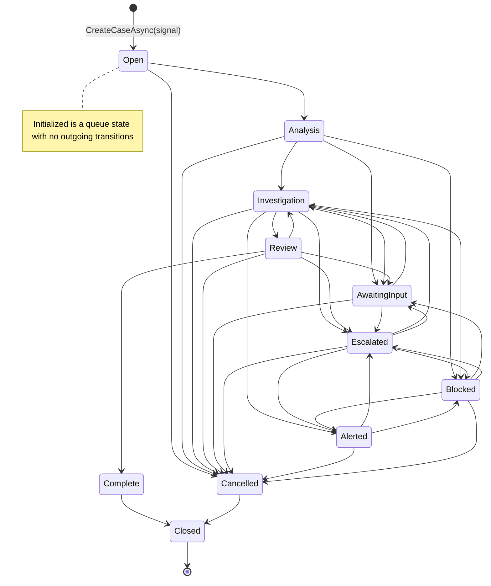

# Getting Started with Sentinel Core

Integration guide for hosts embedding the Sentinel Core libraries. For the plain-language overview of what the platform does, see the [repository README](../README.md).

## Prerequisites

- **.NET 10 SDK** (`net10.0-windows` target)
- **SQL Server** (local or remote) for persistence
- **Ollama** (or another model endpoint) for local AI inference
- **Environment variables** — `SENTINEL_CORE` (case-flow database connection string) and `REMOTEKB` (remote knowledge-base connection string). The WPF host fails fast at startup when either is missing.

## 1. Configure settings

Create `SentinelCoreSettings` and assign model profiles by `ModelTier`. Agent presets declare which tier they use; a missing profile prevents agent construction for that tier.

```csharp
var settings = new SentinelCoreSettings
{
	SqlConnectionString = "Server=.;Database=SentinelCore;Integrated Security=true;TrustServerCertificate=true",
	OrchestrationType = OrchestrationType.TheCore,
	RagSearch = RagSearchOptions.Default,
	SafetyEngine = new SafetyEngineSettings { IsEnabled = true },
	TraceEnabled = true,
	TraceLogLevel = LogLevel.Trace
};

var ollama = new ModelProfile(
	endpoint: "http://127.0.0.1:11434",
	modelId: "llama3.2",
	temperature: 0.2f,
	maxOutputTokens: 16000,
	topK: 1,
	topP: 0.1f,
	provider: ModelProfile.ModelProvider.Ollama);

settings.TierModels[ModelTier.Core] = ollama;
settings.TierModels[ModelTier.Manager] = ollama;
settings.TierModels[ModelTier.Utility] = ollama;
settings.TierModels[ModelTier.GroupWorker] = ollama;
```

## 2. Register services

Register the library in the host, then opt into persistence and the host-owned EF Core factory where required:

```csharp
services.AddSentinelCore(settings);
services.AddCaseFlowEngine();
services.AddDbContextFactory<SentinelCoreDBContext>(options =>
	options.UseSqlServer(Environment.GetEnvironmentVariable("SENTINEL_CORE")));
```

`AddSentinelCore` registers orchestration, agent creation, workflow executors, events, RAG, MCP lifecycle, reporting, local tools, and null-object defaults for case-flow persistence. It does not register the real case-flow module or a `DbContext` factory. `AddCaseFlowEngine` replaces the null implementations, and the host must align that opt-in with `AddDbContextFactory<SentinelCoreDBContext>` as required by pattern-lock PL-7.

The active WPF host registers `SentinelCoreDBContext`. `SentinelRAGDBContext` exists in the repository, but its DI registration and usage are currently commented out.

## 3. Subscribe to events

```csharp
var events = serviceProvider.GetRequiredService<ISentinelCoreEvents>();

events.SentinelOutputEvent += (args) =>
{
	// args.AgentName, args.Message, args.ActivityType
	Console.WriteLine($"[{args.ActivityType}] {args.AgentName}: {args.Message}");
};

events.ErrorOccurred += (message, exception) =>
{
	Console.Error.WriteLine($"ERROR: {message}", exception);
};
```

## 4. Start an investigation

```csharp
var orchestrationControl = serviceProvider.GetRequiredService<IOrchestrationControl>();

await orchestrationControl.InitializeOrchestrationAsync(cancellationToken);

IAsyncEnumerable<WorkflowEvent> events = await orchestrationControl.ExecuteStreamingAsync(
	new ChatMessage(ChatRole.User, "Investigate Event log error 123456"),
	cancellationToken);
```

`InitializeOrchestrationAsync` is idempotent. Callers consume the returned workflow-event stream to process output and progress.

## Optional: custom safety rules

`SafetyExecutor` receives `IEnumerable<ISafetyRule>` from DI. When no rules are registered, it uses its 13 built-in defaults; when rules are supplied, they replace the default collection for that executor.

```csharp
public sealed class BusinessHoursRule : ISafetyRule
{
	public string Name => "BusinessHours";
	public string Description => "Blocks high-risk operations outside business hours.";

	public Task<SafetyRuleResult> EvaluateAsync(
		SafetyEvaluationContext context,
		CancellationToken cancellationToken = default)
	{
		return Task.FromResult(IsOutsideBusinessHours()
			? SafetyRuleResult.Block(Name, SafetySeverity.High, "Outside approved operating hours.")
			: SafetyRuleResult.Allow(Name));
	}
}

services.AddSingleton<ISafetyRule, BusinessHoursRule>();
services.AddSentinelCore(settings);
```

`SafetyEngineSettings` documents intended configuration but is not currently consulted by `SafetyExecutor` for all switches. The executor evaluates the supplied rules, then reads the block flag from the original message's `IsAllowed` metadata. Because `ApplySafetyTags` is commented out, a normal message that triggers a block can still produce an allowed-route result. Treat this as a known implementation gap, not an enforced safety guarantee. See [SafetyEngineComponent.md](./SafetyEngineComponent.md).

## Optional: MCP servers

MCP servers are registered at runtime and their tools are injected into agents by `SentinelAgentFactory`. Definitions persist to `%APPDATA%\SentinelCore\mcp-servers.json` (override with `SENTINEL_MCP_REGISTRY_PATH`); OAuth tokens are cached DPAPI-encrypted in `mcp-tokens.bin`.

```csharp
var registry = serviceProvider.GetRequiredService<IMcpServerRegistry>();

await registry.RegisterAsync(new McpServerDefinition(
	id: "windows-toolkit",
	displayName: "Windows Troubleshooting Toolkit",
	transportType: McpServerTransportType.Stdio,
	commandOrEndpoint: "SentinelCore.Mcp.Windows"));

await registry.StartAsync("windows-toolkit", cancellationToken);
```

A server definition carries no per-agent assignment. Which agent receives a server's tools is decided at agent creation time by the preset's declared tool groups, optionally overridden at the call site through `AgentToolSelection` — see [ToolingComponent.md](./ToolingComponent.md). The WPF host exposes server management through the **MCP Servers** page.

## Key abstractions

### Contracts (`SentinelCore.Contracts`)

| Type | Description |
| --- | --- |
| `ICaseFlowEngine` | Owns the case lifecycle. Create cases and advance status. |
| `IEvidenceStore` | Append and retrieve evidence items for a case. |
| `IPatternMemoryStore` | Store and search vectorized case patterns. |
| `ISignalRepository` | Persist and retrieve signals. |
| `ISentinelCoreEvents` | Event hub for UI integration (output, errors, orchestration). |
| `ISystemReporter` | Report errors, warnings, and info to logging + event stream. |
| `IMcpServerRegistry` | Register, start, stop, and query MCP servers; publish their tools. |
| `IMcpServerRegistryStore` | Persistence abstraction for MCP server definitions. |
| `ISentinelCoreBuilder` | Configures optional SentinelCore modules during host startup. |
| `CaseStatus` | The 12 case lifecycle statuses. |
| `SentinelCoreSettings` | All configurable runtime options passed to `AddSentinelCore`. |
| `ModelProfile` | Model endpoint and tuning parameters for a single agent. |

### Case flow (`SentinelCore.CaseFlowEngine`)

| Type | Description |
| --- | --- |
| `CaseFlowEngine` | Default `ICaseFlowEngine` implementation. Validates transitions against `AllowedTransitions`. |
| `EvidenceStore` | EF Core implementation of `IEvidenceStore`. |
| `PatternMemoryStore` | EF Core implementation of `IPatternMemoryStore`. |
| `SignalRepository` | EF Core implementation of `ISignalRepository`. |
| `SentinelCoreDBContext` | EF Core DbContext for case-flow persistence. |
| `SentinelRAGDBContext` | EF Core DbContext for the remote knowledge base (`RemoteSources`, `SourceDocs`). |

### Safety engine (`SentinelCore.Orchestrations.SafetyEngine`)

| Type | Description |
| --- | --- |
| `ISafetyRule` | A self-contained, stateless rule that evaluates a prompt for safety concerns. |
| `SafetyRuleEngine` | Evaluates multiple rules sequentially and aggregates their results. |
| `SafetyEngineAgent` | Separate agent wrapper around the rule engine; not the active `TheCoreWorkflow` safety gate. |
| `SafetyEvaluationContext` | Prompt messages passed to each rule. |
| `SafetyRuleResult` | Outcome of a single rule evaluation. |
| `SafetySeverity` | Severity level used by rule evaluation and aggregation. |
| `Rules/*` | Reusable safety-rule implementations; `SafetyExecutor` defaults to 13 of them. |

### Orchestration (`SentinelCore.Orchestrations`)

| Type | Description |
| --- | --- |
| `TheCoreWorkflow` | Main investigation workflow with signal classification and switch routing. |
| `CustomGroupWorkflow` | Isolated harness for testing agents and workflows outside the main pipeline. |
| `OrchestrationControl` | `IOrchestrationControl` implementation — starts an orchestration. |
| `OrchestrationFactory` | Resolves configured `IOrchestration` instances through DI. |
| `SentinelAgentFactory` | Builds `AIAgent` instances from `AgentPreset`, model tier, and tool selection. |
| `AgentPresetDefinition` | Role definition containing instructions, model tier, and feature flags. |
| `ModelResolver` | Resolves a `ModelProfile` for an agent's `ModelTier`. |
| `AgentToolSelection` | Selects no tools, all tools, named tools, or domain-rule-derived tools. |
| `McpServerRegistry` | Persists, starts, stops, and caches MCP server connections and tools. |
| `RagSearchService` | Keyword/fuzzy RAG search with a currently unused vector interface. |
| `PersonaRegistry` | Persona definitions used by preset-oriented agent construction. |
| `CaseEngineTools` | Local case creation, report, and pattern-summary functions registered as `AITool` values. |

## Model providers

`ModelProfile.ModelProvider` declares several provider values, and the active `SentinelChatClientFactory` switch constructs a client for each of them.

| Provider | Current default-factory status |
| --- | --- |
| `Ollama` | Implemented (`OllamaSharp`) |
| `OpenAI` | Implemented (`Microsoft.Extensions.AI.OpenAI`) |
| `AzureOpenAI` | Implemented (`Azure.AI.OpenAI`) |
| `GitHubModels` | Implemented (OpenAI client against the Models endpoint) |
| `Anthropic` | Implemented via `Anthropic.SDK` (`AnthropicClient.Messages` implements `IChatClient`) |
| `Foundry` | Implemented (OpenAI client against the Foundry OpenAI-compatible v1 endpoint) |
| `Azure` | Implemented via `Azure.AI.Inference` + `Microsoft.Extensions.AI.AzureAIInference` (`AsIChatClient` adapter) |
| `OnnxRuntime` | Implemented via `Microsoft.ML.OnnxRuntimeGenAI.Managed` (`OnnxRuntimeGenAIChatClient`); text-only; uses `ModelProfile.ModelPath` and the optional `ModelProfile.ExecutionProvider` (CPU, CUDA, DML, QNN, OpenVINO, VitisAI) |

## Case lifecycle

The `CaseFlowEngine` is the **single owner** of case state. No agent, orchestrator, or host may mutate `CaseStatus` directly — all transitions flow through `ICaseFlowEngine.AdvanceCaseAsync()`.



Every transition is validated against the `AllowedTransitions` dictionary in `CaseFlowEngine`. `CaseStatus.Initialized` is a queue state for cases that have been created but not yet handed to the workflow; it has no outgoing transitions in the table.

## Related documents

- [SolutionArchitecture.md](./SolutionArchitecture.md) — solution boundaries and registration flow
- [OrchestrationComponent.md](./OrchestrationComponent.md) — workflow and execution surfaces
- [CaseFlowEngineComponent.md](./CaseFlowEngineComponent.md) — lifecycle boundary and persistence opt-in
- [SafetyEngineComponent.md](./SafetyEngineComponent.md) — active safety rules and known gaps
- [SecurityComponent.md](./SecurityComponent.md) — provenance signing and quarantine
- [McpServerRegistryComponent.md](./McpServerRegistryComponent.md) — MCP registry and tool publication
- [PersistenceComponent.md](./PersistenceComponent.md) — EF Core storage and lifetime rules
- [Documentation-Manifest.md](./Documentation-Manifest.md) — document inventory and status
