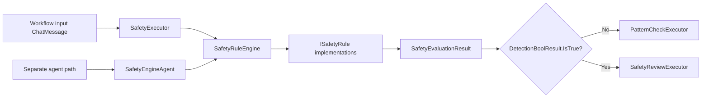

# SentinelCore Safety Engine Component

This document inventories the safety-rule engine and distinguishes the implemented executor path from unfinished integration behavior.

**Project:** `SentinelCore.Orchestrations`

**Namespace:** `SentinelCore.Orchestrations.SafetyEngine`

**Active workflow caller:** `SentinelCore.Orchestrations.Workflows.Executors.SafetyExecutor`

**Related agent adapter:** `SafetyEngineAgent` (separate from the active executor path)

Use this document when changing safety-rule evaluation, workflow routing, or safety metadata propagation.

## Implementation Caveat

`SafetyExecutor` uses 13 default rules when no `ISafetyRule` services are supplied. It evaluates the message, but then derives `isBlocked` from `message.GetMetaTagByKey("IsAllowed")`. The call to `ApplySafetyTags` is currently commented out, so an ordinary incoming message does not receive the fresh verdict. A detected message can therefore proceed as if allowed. Consumers should not treat the active safety gate as enforcing rule outcomes until this defect is corrected.

## Purpose

The Safety Engine evaluates a prompt against configured safety rules before the prompt is allowed to continue through the orchestration workflow. It is a rule-based, fail-safe subsystem that returns structured results and can block unsafe content.

The current implementation has two layers:

1. `SafetyEngineAgent`, which evaluates prompts as middleware in the agent pipeline.
2. `SafetyExecutor`, which is a workflow executor that calls the safety engine and reacts to the resulting safety verdict.

## Current Architectural Role

The executor does not implement the engine itself. It invokes the engine and forwards the result into the workflow graph.

This is the intended split today:

- `SafetyExecutor` is the workflow step.
- `SafetyRuleEngine` evaluates the configured rules.
- `SafetyEngineAgent` is the middleware adapter used by the agent pipeline.
- `BlocklistRule` and the other rules provide the rule-level verdicts.

## Current Runtime Flow



## Contracts

### `ISafetyRule`

Rules are implemented in [SafetyEngine/ISafetyRule.cs](../projects/SentinelCore.Orchestrations/SafetyEngine/ISafetyRule.cs).

```csharp
Task<SafetyRuleResult> EvaluateAsync(SafetyEvaluationContext context, CancellationToken cancellationToken = default);
```

Rules are stateless. They inspect `SafetyEvaluationContext` and return a `SafetyRuleResult`.

### `SafetyEvaluationContext`

The evaluation context provides the input messages and convenience accessors such as `CombinedText`.

### `SafetyRuleResult`

Each rule returns one of the shared outcomes:

- `Allow`
- `Warn`
- `Block`

The result carries the rule name, severity, and reason.

### `SafetyEvaluationResult`

The engine aggregates rule results into a single evaluation object with:

- `IsAllowed`
- `HighestSeverity`
- `Summary`
- `BlockingResult`
- `RuleResults`

## Engine Behavior Today

### `SafetyRuleEngine`

`SafetyRuleEngine` is the canonical engine implementation. It evaluates all registered rules in order and returns a `SafetyEvaluationResult`.

Current behavior:

- Executes each rule sequentially.
- Short-circuits when configured to stop on first block.
- Treats rule failures as blocks by default.
- Emits logging through its internal logger factory.

### `SafetyEngineAgent`

`SafetyEngineAgent` is the middleware-facing adapter that:

- evaluates the same rule set,
- attaches the `SafetyEvaluationResult` into `AgentRunOptions.AdditionalProperties`,
- returns a blocked response when the evaluation fails,
- forwards allowed prompts to the inner agent.

## Workflow Executor Behavior

### `SafetyExecutor`

`SafetyExecutor` is a workflow executor that calls the engine and does not own the safety policy itself.

Current behavior:

- Validates null input and reports through `ISystemReporter`.
- Builds a `SafetyEvaluationContext` from the incoming `ChatMessage`.
- Calls `SafetyRuleEngine.EvaluateAsync(...)`.
- Returns `DetectionBoolResult` where `IsTrue` means the message was detected/blocked.
- Returns the original message. The metadata-tagging call is commented out, so downstream code cannot derive `IsAllowed` from message metadata without explicit state added by a future change.

It is intentionally a caller of the safety engine, not the engine implementation.

## Rule Source

`SafetyExecutor` defaults to 13 rules when no `ISafetyRule` services are supplied. `BlocklistRule` is one of those rules and consumes `SafetyTriggerTerms.GetAllIndicators()`; the remaining defaults cover code injection, data exfiltration, encoding evasion, harmful content, limits, PII, prompt injection, repetition, role escalation, system-prompt extraction, tokens, and URL blocking.

## Template Alignment

Workflow executors should follow the conventions in [ExecutorTemplate.cs](../projects/SentinelCore.Orchestrations/Workflows/Executors/ExecutorTemplate.cs):

- class extends `Executor`
- `[YieldsOutput(typeof(...))]`
- `[MessageHandler]` on the handler method
- conventional constructor
- `ISystemReporter` for executor output
- `ProcessMessageAsync` for domain logic

`SafetyExecutor` now follows that pattern for its logging/output flow and delegates safety evaluation to the engine.

## Known Gaps

The current implementation has unresolved integration gaps:

- `SafetyReviewExecutor` and a blocked-route edge from `SafetyExecutor` exist, but the current message-metadata defect prevents a fresh rule block from reliably reaching that route.
- The review executor is not evidence of a complete human-style or remediation review pipeline.
- Safety settings and output-sanitization options are not consistently applied across the executor path.
- Rule evaluation is implemented, but the `ApplySafetyTags` call remains disabled, so the aggregate verdict is not propagated as trusted message metadata.

## Documentation Scope

This document is the canonical reference for the current safety-engine implementation. It is aligned to what exists in the repository today, not to future proposed behavior.

## Change Table

| Version | Date | Author | Change summary |
| --- | --- | --- | --- |
| 2.0.0 | unknown | unknown | Corrected the active rule count, executor result shape, blocked-route destination, and disabled message-tagging status. |
